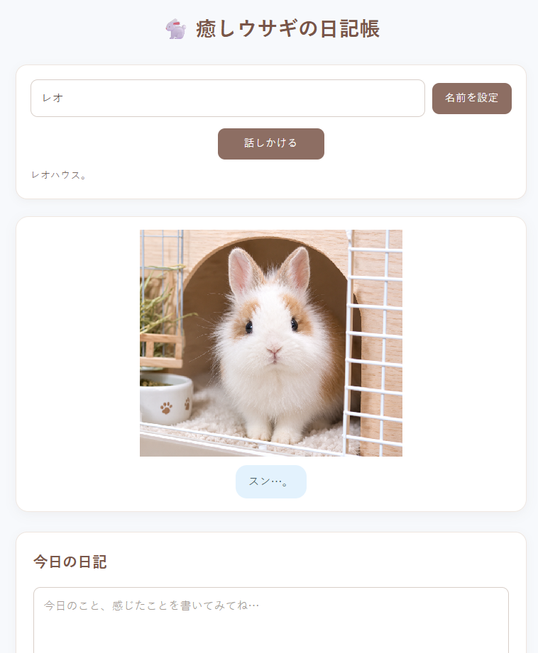

# 🐇 PetApp6 v1.3.3 - Healing Rabbit Diary

[🇯🇵 Japanese Version (README.md)](README.md)

> 🖼️ **PetApp6 Home Screen**
>
> [](https://usakowhity.github.io/PetApp6/)
>
> 🎬 **[Watch the PetApp6 demo on YouTube](https://www.youtube.com/shorts/ECOsiTvbqI8)**

> **Language note:** PetApp6 v1 is a Japanese-language app. The interface, speech recognition, Direct Talk trigger words and diary keyword rules are all in Japanese, so English phrases such as "Leo, good morning" will not trigger reactions. English translations in this document are for reference only.

PetApp6 is a virtual pet diary application that inherits the functionality, file structure, and world of PetApp5 v3.2.7 while adding a diary notebook system.

It is built on PetApp5's Direct Talk, speech recognition, Diary → Emotion/Need → Rabbit Action, and Idle Layer, and adds diary saving, list/detail views, editing, deletion, and printable/PDF diary output with thumbnails.

PetApp6 also keeps the v1.2.1 design that separates normal Rabbit Action media from static images used for diary records and printing. v1.2.2 refined the print/PDF implementation, v1.3.0 added Direct Talk actions R22 and R23 and expanded Rabbit Actions to R01-R23, and v1.3.1 fixed a problem where Japanese orthographic variations such as “嬉しい / うれしい” and “良かった / よかった” were not consistently recognized as joy, causing different rabbit reactions.

v1.3.2 improved the README files (home screen image, YouTube demo link, Japanese/English cross-links) without changing the application.

**v1.3.3 expands the rabbit's reactions to diary entries so that all 23 Rabbit Actions (R01–R23) can appear from the diary, Direct Talk or the idle behavior.** It also fixes video-based actions (such as R08) so that diary thumbnails, diary details and printed/PDF diaries use still images (PNG).

All rabbit images and videos in PetApp6 were created with generative AI.

---

## ✨ 1. Overview

PetApp6 extends PetApp5 rather than replacing it. Existing functionality, modules, and image assets are preserved while new diary features are added.

### Main Features

- Customizable pet name
- Direct Talk using the configured pet name
- SpeechRecognition support
- Diary saving, list, and detail views
- Rabbit Action reactions associated with diary entries
- Diary editing and deletion
- Printable diary book with thumbnails / PDF saving
- Rabbit Action R01-R23
- MP4-based Rabbit Action playback
- Static print images for diary list/detail and printing
- Time-based Idle Layer
- Diary reactions chosen at random from several candidates per feeling

---

## 🎙️ 2. Direct Talk

Direct Talk lets users speak to the rabbit by placing the configured pet name at the beginning of the utterance.

Direct Talk is **voice-only**. Speech recognition is set to Japanese (`ja-JP`) and works in browsers that support it, such as Chrome or Edge. The rabbit reacts only when the recognized text starts with the configured pet name, so use a name that speech recognition writes the same way (for example, a katakana name such as レオ).

For example, if the pet name is レオ (Leo):

- レオ、おはよう — "Good morning"
- レオ、元気 — "How are you?"
- レオ、かわいい — "You're cute"
- レオ、おやすみ — "Good night"
- レオ、ごはん — "Food"
- レオ、お水 — "Water"
- レオ、トイレ — "Toilet"
- レオ、ハウス — "House"
- レオ、散歩 / おそと — "Walk / outside"
- レオ、おめでとう — "Congratulations"
- レオ、ハッピーバースデー — "Happy birthday"

The pet name is fully customizable.

### Direct Talk Dictionary

| Say (Japanese) | Meaning | Action ID | Reaction |
|---|---|---|---|
| おはよう | Good morning | R10 | Morning greeting |
| 元気 | How are you? | R11 | Checking condition |
| かわいい / 可愛い / カワイイ / いいこ / おりこう / お利口 | Cute / good bunny | R14 | Joy reaction |
| おやすみ | Good night | R15 | Rest |
| ねんね | Sleepy time | R08 | Sleeping reaction |
| おいで | Come here | R16 | Response to calling |
| ごはん | Food | R19 | Eating |
| 牧草 / チモシー | Hay / timothy | R17 | Eating hay |
| 水 / お水 | Water | R18 | Drinking |
| お腹すいた | I'm hungry | R03 | Hungry reaction |
| トイレ / おしっこ / ちっち / シー | Toilet | R20 | Toilet reaction |
| ハウス / おうち | House | R21 | Entering the house |
| 散歩 / おそと | Walk / outside | R22 | Going outside |
| おめでとう / ハッピーバースデー | Congratulations / happy birthday | R23 | Celebration |

---

## 📖 3. Diary Notebook

PetApp6 stores diary text and date information in the browser's `localStorage`. No account registration is required.

The diary notebook supports:

- Save diary entries
- View the diary list
- View diary details
- Edit and append diary entries
- Delete entries
- Associate Rabbit Actions with entries
- Display representative print images
- Print the diary book
- Save as PDF using the browser's print dialog

### Diary reactions (expanded in v1.3.3)

When a diary is saved, lightweight rule-based processing in `app.js` detects Emotion and Need from Japanese keywords and selects a Rabbit Action. No LLM is used.

| Keywords in the entry (Japanese) | Possible Rabbit Actions |
|---|---|
| tired / exhausted / sleepy (疲, しんどい, きつ, だる, 眠い) | R15 / R05 / R08 (1/3 each) |
| sad / painful / crying (悲, つら, 泣, 涙, ショック …) | R01 / R02 / R06 / R07 (1/4 each) |
| anxious / worried / scared (不安, 心配, 怖, びくびく) | R03 / R09 / R10 / R12 (1/4 each) |
| lonely (寂, 孤独, しゅん) | R01 / R02 / R05 / R06 / R16 (1/5 each) |
| happy / fun / glad (嬉, うれし, 楽し, 良かった, よかった, いいね, ご機嫌, ラッキー) | R14 |
| angry / irritated (怒, おこ, イラ, むか, プンプン) | R11 / R12 (1/2 each) |
| anything else | R04 / R13 (1/2 each) |

- If an entry contains several feeling words, the first matching row is used, in this order: tired → sad → anxious → lonely → happy → angry.
- When several actions are possible, one is chosen at random from all of them with equal probability. The selector was fixed in v1.3.3: previously only the first three candidates were eligible, so later candidates were never chosen.
- Saved entries keep their original reaction (`actionId`).

### Joy recognition (fixed in v1.3.1)

The following expressions are recognized as `joy` with Need `share_joy`, resulting in **R14 “ぴょんっと喜ぶ”**:

| Expression pattern | Examples |
|---|---|
| 嬉 / うれし | 嬉しい, うれしい, うれしかった |
| 楽し | 楽しい, 楽しかった |
| 良かった / よかった | 良かった, よかったな |
| いいね | いいね |
| ご機嫌 | ご機嫌 |
| ラッキー | ラッキー |

The regular expression used by `detectEmotionNeed()` is:

```js
/嬉|うれし|楽し|良かった|よかった|いいね|ご機嫌|ラッキー/
```

Thus, kanji and hiragana spelling variations produce the same rabbit reaction.

If no emotion rule matches, the default is `pleasant` with Need `companionship`, resulting in R04 “じっと隣で見守る” or R13 “そっと励ます（正面座り）”.

Processing flow:

```text
Diary text
   ↓ detectEmotionNeed() (app.js)
Emotion × Need
   ↓ action_mapping.json
Candidate Rabbit Actions
   ↓ rabbitActionSelector.js (equal-probability choice)
Rabbit reaction
```

To add feeling words, edit the regular expressions in `detectEmotionNeed()`. To change which actions are candidates, edit `data/action_mapping.json`. Neither requires changes to `rabbitActionSelector.js`.

---

## 🖼️ 4. Rabbit Action Media Design

Rabbit Actions use two media roles.

### `image`

The normal interaction media used by Direct Talk, Diary Reaction, and Idle Layer. It can be PNG or MP4.

### `print_image`

The static representative image used for:

- Diary thumbnails
- Diary details
- Printed diary books
- PDF output

MP4-based actions therefore have a corresponding PNG for printing.

Example:

```json
{
  "id": "R08",
  "name": "ごろんと安心する",
  "image": "assets/rabbit/actions/R08.mp4",
  "print_image": "assets/rabbit/actions/R08.png"
}
```

Current MP4 actions with print images:

- R08 → R08.mp4 / R08.png
- R17 → R17.mp4 / R17.png
- R18 → R18.mp4 / R18.png
- R19 → R19.mp4 / R19.png

### v1.3.3 implementation note

`print_image` entries (PNG files) were added for R08, R17, R18 and R19 in `rabbit_actions.json`, and `getActionImagePath()` in `app.js` now prefers `print_image` (falling back to the PNG with the same name for video actions). Diary thumbnails, diary details and printing/PDF use this still image, while the normal rabbit display (`uiRenderer.js`) keeps using `image` (PNG or MP4).

---

## 🗂 5. Project Structure

```text
PetApp6/
├─ index.html
├─ js/
│  ├─ app.js
│  ├─ uiRenderer.js
│  ├─ rabbitActionSelector.js
│  ├─ dataLoader.js
│  └─ diaryStorage.js
├─ data/
│  ├─ rabbit_actions.json
│  └─ action_mapping.json
├─ css/
│  └─ style.css
├─ docs/
│  └─ images/
│     └─ petapp6-main.png    # home screen screenshot
└─ assets/
   └─ rabbit/
      └─ actions/
         ├─ R01.png ... R23.png
         ├─ R08.mp4
         ├─ R17.mp4
         ├─ R18.mp4
         └─ R19.mp4
```

---

## 🖨️ 6. Printing and PDF Export

1. Enter a diary entry and press the button to save it to the diary.
2. Open the Diary Notebook.
3. Press **Print / Save PDF**.
4. Use the browser print dialog to print or select **Save as PDF**.

No external PDF library is required. Print output uses `print_image` rather than MP4 media.

In v1.3.3, video-based actions such as R08 (which can be chosen for tired diary entries) are shown as still images in the printed/PDF diary.

---

## 💾 7. Data Storage

Diary entries are stored in browser `localStorage`.

Storage key:

```text
petapp6_diaries
```

The stored record uses `actionId`, not an image filename. This allows Rabbit Action media to change without rewriting existing diary records.

The v1.3.1 emotion-recognition fix applies to newly saved diary entries; existing saved `actionId` values are not rewritten.

The expanded reactions in v1.3.3 also apply only to newly saved entries.

Diary text and reactions are stored only in your browser. The app's code loads nothing outside its own files and does not send your diary anywhere. Direct Talk uses your browser's built-in speech recognition, which in some browsers may process audio on the browser vendor's servers.

---

## 🚀 8. Live Sites

- **GitHub Pages (Main):** https://usakowhity.github.io/PetApp6/
- **Vercel (Fast Mirror):** https://petapp6.vercel.app/
- **Netlify (Portal):** https://petapp6.netlify.app/
- **GitHub Repository:** https://github.com/usakowhity/PetApp6
- **YouTube Demo:** https://www.youtube.com/shorts/ECOsiTvbqI8

---

## 📦 9. Release Information

- **Version:** v1.3.3
- **Previous version:** v1.3.2
- **Release type:** Feature / Fix
- **Main changes:**
  - Expanded diary reactions (tired, sad, anxious, lonely, angry, and the default case)
  - The selector now chooses from all candidates with equal probability (previously only the first three)
  - Video-based actions (e.g. R08) now use still images (PNG) in diary thumbnails, diary details and printing/PDF
  - All Rabbit Actions R01–R23 can now appear from the diary, Direct Talk or the idle behavior
  - README now documents the already-implemented trigger words (いいね / いいこ) and states that the app is Japanese-language
- **Compatibility:** Existing diary data (`localStorage`, `actionId`) keeps working without migration
- **Verification:** Still-image display in the diary list, diary details and PDF export, and video display of R08, were checked
- **Images and videos:** All created with generative AI
- **Developer:** usakowhity
- **License:** MIT

### Version History

- **v1.3.3:** Expanded diary reactions, fixed the selector (all candidates are eligible), fixed still-image display for video-based actions, and made all of R01–R23 reachable
- **v1.3.2:** Improved README files, home screen image, YouTube demo link, and Japanese/English README cross-links (Documentation / Presentation Update)
- **v1.3.1:** Fixed Japanese spelling variations such as “うれしい” and “良かった” in joy detection
- **v1.3.0:** Added Direct Talk R22 “Walk / Outside” and R23 “Congratulations / Happy Birthday”
- **v1.2.2:** Refined diary printing / PDF display
- **v1.2.1:** Separated `image` and `print_image` for Rabbit Actions

---

## 🛠 Development Policy

PetApp6 follows an additive development policy:

- Preserve existing PetApp5 functionality
- Reuse existing JavaScript modules and image assets
- Keep diary functionality modular
- Extend Direct Talk using the existing mechanism
- Maintain compatibility and future extensibility
- Keep media roles clearly separated

**A feature may remain unused, but the foundation needed for future extensions should not be removed.**

---

## 📄 License

MIT License. See the `LICENSE` file for details.

---

## 👨‍💻 Developer

usakowhity

PetApp Series

© 2026 usakowhity
